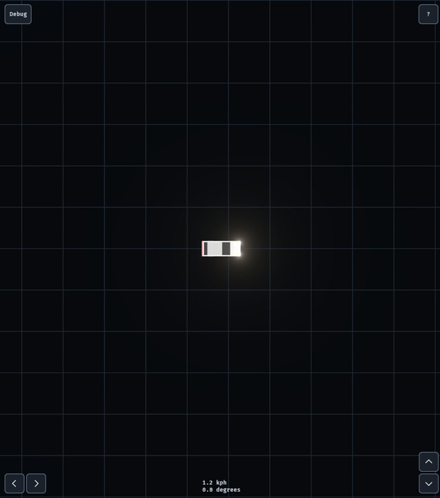

# cars

<p align="center"></p>

This project was inspired by Pat Kerr's [2D Vehicles](https://patkerr.co.uk/2d-vehicles/) as a throwback to his initial vehicle physics implementation that was included in GTA.

As my throwback to projects that are certainly equally successful, I've chosen to use the dynamic bicycle model that we use in [winstxnhdw/AutoCarROS2](https://github.com/winstxnhdw/AutoCarROS2), and the late [NP-DevCar](https://github.com/reuben-thomas/NP-DevCar/tree/master).

Try it at [reuben-thomas.github.io/cars](https://reuben-thomas.github.io/cars/).

**Prerequisites**

- [Rust](https://rustup.rs/)
- [just](https://github.com/casey/just)

**Setup**

```sh
git clone https://github.com/reuben-thomas/cars.git
cd cars
just run
```
